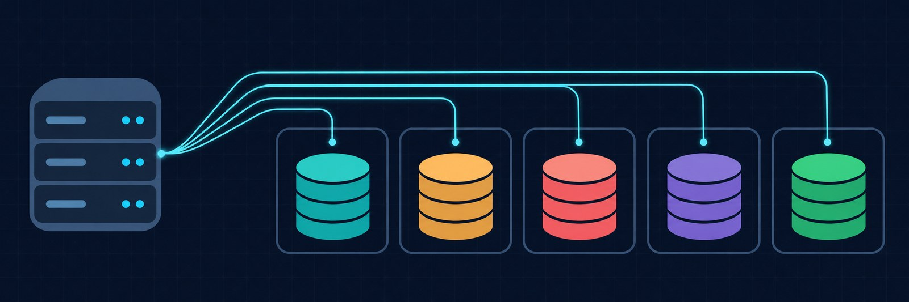
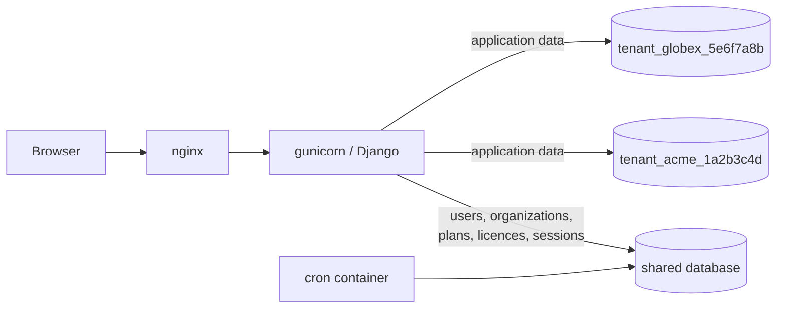
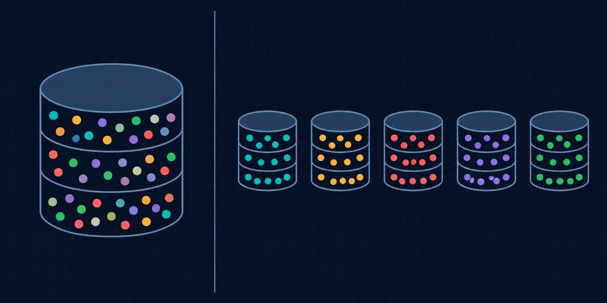

# django-multitenant-starter



[](https://github.com/krusicb90/django-multitenant-starter/actions/workflows/ci.yml)

A Django starter for B2B SaaS applications where **every customer gets its own PostgreSQL database**.

It covers the parts every such product needs before the first feature: signup that provisions a tenant database, routing each request to the right database, plans, trials and licences, invitations, a platform admin panel with impersonation, and a deployment with backups that can restore a single tenant.

The tenancy model, the licence rules and the deployment scripts are taken from a SaaS application that runs in production. The product itself is replaced here by a small example app (`notes`).

## Architecture



There are two kinds of apps:

| | Database | Apps |
|---|---|---|
| Shared | `default` | `accounts`, `organizations`, `superadmin`, Django's auth, sessions and admin |
| Tenant | one per organization | everything listed in `TENANT_APPS` (here: `notes`) |

How a request finds its database:

1. `TenantMiddleware` reads the signed-in user's organization and makes it the current tenant for the duration of the request.
2. `TenantDatabaseRouter` sends every query on a tenant model to that organization's database, and every query on a shared model to `default`.
3. Tenant databases are not listed in `settings.DATABASES`. Each one is registered at runtime, the first time a process needs it, as a copy of the default connection settings with a different database name.

Views in a tenant app contain no tenant filtering at all:

```python
@tenant_required
def note_list(request):
    return render(request, "notes/list.html", {"notes": Note.objects.all()})
```

## What is included

**Tenancy** (`tenancy/`)
- Database router, tenant context and middleware
- Provisioning: create the database, migrate it, run seed hooks; safe to repeat after a failure
- Commands: `setup_tenant`, `migrate_tenants`, `create_tenant_db`, `drop_tenant_db`

**Accounts and organizations** (`accounts/`, `organizations/`)
- Signup creates the organization, its owner and a trial
- Email verification; the tenant database is created when the address is confirmed
- Invitations with roles (admin, member, read-only), member deactivation
- Password reset

**Plans and licences** (`organizations/licensing.py`)
- Trial, activation, extension, cancellation, grace period, expiry
- Plan limits on users and on tenant records
- An expired organization becomes read-only instead of locked out
- Daily jobs: expire licences, email reminders before a trial or licence ends

**Platform admin** (`superadmin/`)
- Organizations with plan, licence and database status
- Activate, extend and cancel licences, suspend organizations, delete an organization with its database
- Sign in as a member (impersonation), with an audit log
- IP blocking and a log of rate-limited requests

**Security**
- Rate limiting on login, signup and resend, adjustable at runtime
- Cloudflare Turnstile on login and signup (optional)
- Queries on tenant data without a tenant fail instead of falling back to another database

**Operations** (`Dockerfile`, `deploy/`, `.github/workflows/`)
- Image that runs as a non-root user; scheduled jobs in a separate container
- nginx configuration for a site behind Cloudflare
- `deploy.sh`: pull, pre-deploy backup, start, wait for health, roll back automatically
- `backup.sh` / `restore.sh`: one dump per database, checksums, retention, off-site copy, single-tenant restore
- `server-setup.sh`: bootstrap of a fresh Ubuntu host
- CI: lint, tests on SQLite and PostgreSQL, image build with an end-to-end signup

## Quick start

```bash
docker compose up --build
```

Open http://localhost:8000/register/ and create an organization. In this setup email verification is skipped and emails are printed to the container log. Then look at the databases:

```bash
docker compose exec db psql -U app -d app_main -c '\l'
```

There is `app_main` (shared) and one `tenant_<slug>_<id>` per organization you registered.

The platform admin panel is at http://localhost:8000/superadmin/ (user `admin`, password `dev-only-password`).

Without Docker: create a PostgreSQL database, set the variables from `.env.example`, then

```bash
pip install -r requirements-dev.txt
python manage.py migrate
python manage.py seed_plans
python manage.py runserver
```

## Adding your own tenant app

1. Create the app and add its label to `TENANT_APPS` and `INSTALLED_APPS` in `config/settings.py`.
2. Write models as usual. Do not add foreign keys to shared models such as `User`: a foreign key cannot cross databases. Store the id instead (see `notes.models.Note.author_id`).
3. Protect views with `@tenant_required` or `@org_admin_required`.
4. `python manage.py makemigrations`, then `python manage.py migrate_tenants` to apply the migration to every existing tenant. New tenants get it during provisioning.
5. Optional: add a function to `TENANT_SEED_HOOKS` to create initial data in each new tenant database.

Outside a request (commands, scheduled jobs, the shell), select the tenant explicitly:

```python
from tenancy.context import tenant_context

for organization in Organization.objects.filter(db_ready=True):
    with tenant_context(organization):
        Note.objects.count()
```

## Management commands

| Command | Purpose |
|---|---|
| `migrate` | Migrates the shared database only |
| `migrate_tenants` | Migrates every tenant database; exits non-zero if any fails |
| `setup_tenant <slug>` | Creates, migrates and seeds the database of one organization |
| `create_tenant_db <name>` / `drop_tenant_db <name>` | Low-level database creation and removal |
| `seed_plans` | Creates the trial plan and example tiers |
| `ensure_superuser` | Creates the platform admin from `SUPERUSER_*` variables |
| `expire_licences` | Marks ended trials and licences past the grace period as expired |
| `send_licence_reminders` | Emails owners before a trial or licence ends |

## Licence model

- A new organization starts on the trial plan for `TRIAL_PERIOD_DAYS`.
- A platform admin activates a licence (monthly or yearly term) and extends it. Payment is handled outside the application; there is no payment provider integration.
- Extending a running licence continues from the end of its term. Extending a lapsed one starts from today.
- After the term ends the licence stays valid for `LICENCE_GRACE_DAYS`, then `expire_licences` marks it expired.
- Without a valid licence the organization is read-only: every page still opens, state-changing requests are refused.

## Deployment

The files in `deploy/` describe one Docker host with PostgreSQL outside of it (a managed service or a separate server). The database user needs the `CREATEDB` privilege.

```bash
# once, on a fresh Ubuntu 24.04 host
bash server-setup.sh

# copy docker-compose.prod.yml (as docker-compose.yml), nginx.conf.template and the
# scripts to /opt/app, fill /opt/app/.env from .env.production.example, then:
/opt/app/deploy.sh <image-tag>
/opt/app/deploy.sh --rollback
```

On start the container migrates the shared database and then every tenant database. If any of them fails, the container does not start, the health check never passes and `deploy.sh` puts the previous image back.

Backups:

```bash
/opt/app/backup.sh                                              # nightly from cron
/opt/app/restore.sh <archive> --list
/opt/app/restore.sh <archive> --yes --db tenant_acme_1a2b3c4d   # one tenant
/opt/app/restore.sh <archive> --yes                             # everything
```

## Tests

```bash
pytest                                  # SQLite, three in-memory databases
TEST_DATABASE=postgres DB_HOST=... pytest   # PostgreSQL, including real CREATE/DROP DATABASE
```

The suite uses one shared and two tenant databases and covers, among other things:

- rows written by one tenant are not visible to another, through the ORM and through HTTP
- ids from another tenant do not resolve
- tenant tables do not exist in the shared database, and the other way round
- the tenant context is cleared after a request, also when the view raises
- signup, verification, provisioning and retry after a failed provisioning
- licence rules, including month-end dates and the grace period
- impersonation cannot be triggered from an ordinary user's session

## Design decisions



**A database per tenant.** Compared with a `tenant_id` column or a schema per tenant, this gives the strongest isolation and makes three operations simple: restoring one customer from backup, deleting one customer completely, and moving one customer elsewhere. The price is that every migration runs once per tenant and that queries across tenants are not possible.

**The tenant comes from the user, not from the hostname.** A user belongs to one organization and the organization decides the database. There are no per-tenant subdomains to configure, and a wrong hostname cannot select a wrong database.

**No fallback database.** A query on a tenant model outside a tenant context raises `TenantContextMissing`. Falling back to the shared database would turn a missing context into data in the wrong place.

**The database is created on email verification, not on signup.** A bot that submits the signup form does not get to create databases. Verification happens on POST, because mail scanners follow links and would spend a token consumed on GET.

**Read-only instead of lockout.** A customer whose licence expired can still sign in and read their data.

**Connections do not accumulate.** Tenant connections are opened when a request needs them and closed when it ends (Django's default `CONN_MAX_AGE=0`), so open connections scale with concurrent requests, not with the number of tenants.

**Rate limits live in the cache.** With the in-memory cache each gunicorn worker counts separately; the production stack sets `REDIS_URL` so that all workers share the counters.

## Scope

- One PostgreSQL server holds all tenant databases.
- A user belongs to one organization.
- Licences are managed by a platform admin; there is no checkout.
- The user interface is intentionally plain: server-rendered Bootstrap pages that show the flows.

## License

[MIT](LICENSE)
